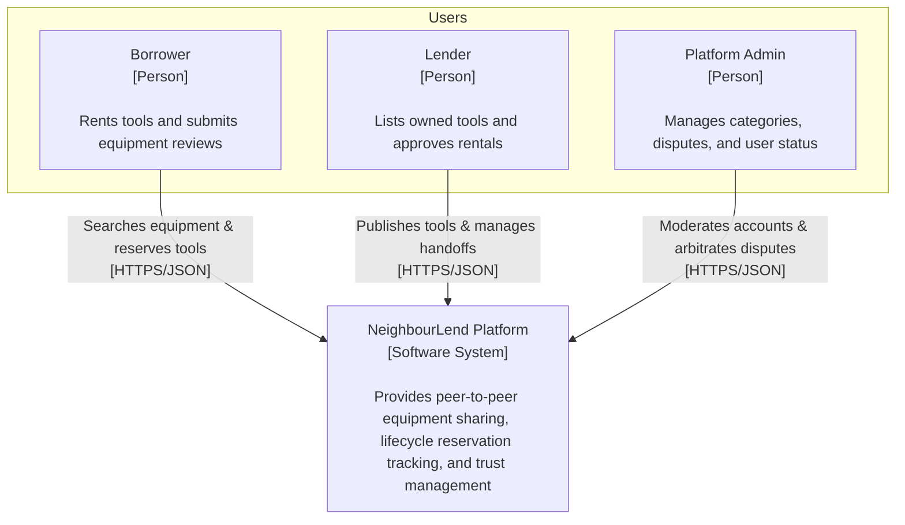
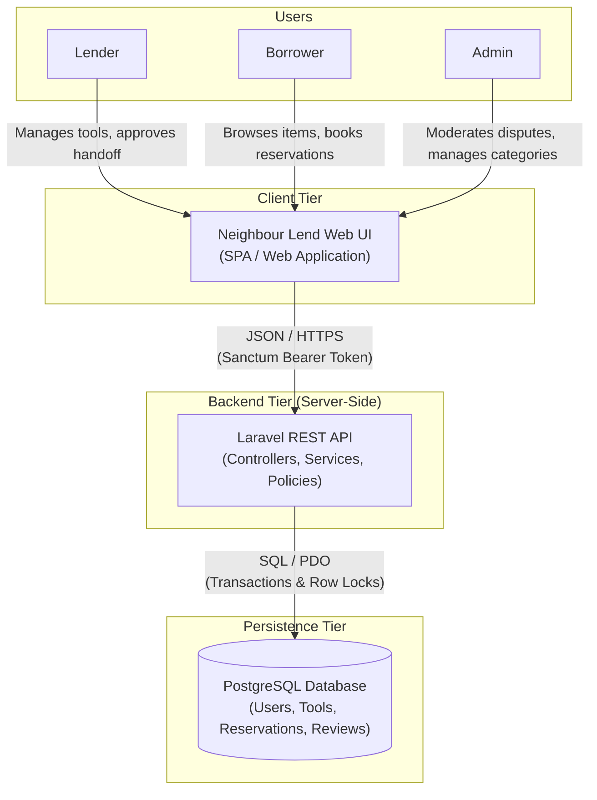
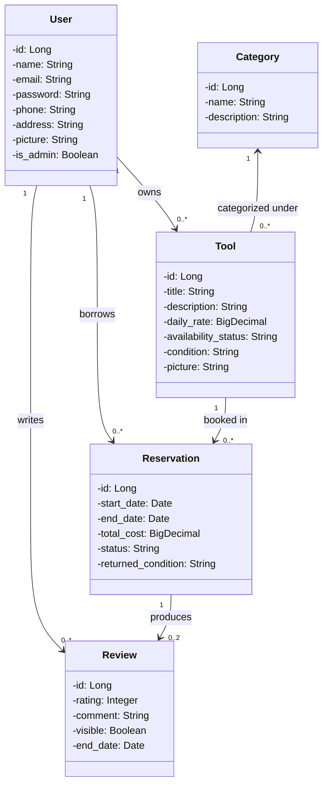
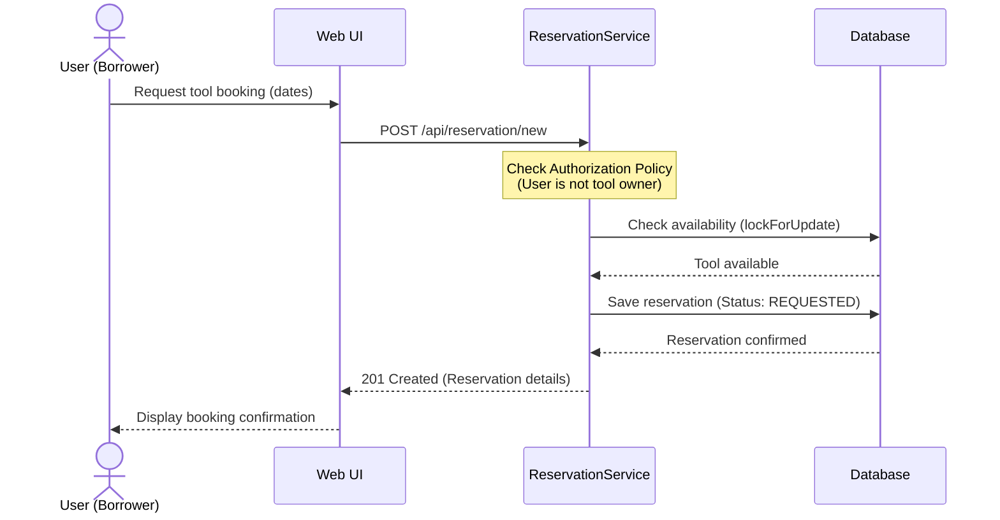

# NeighbourLend: Community Equipment & Tool Sharing Hub

<!--CI badge: after Session 4, replace ORG/REPO and the workflow filename, then uncomment:-->


**Student:** Leduan Flores · **Course:** CEN 5064 Software Design, Fall 2026 · **Partner:** Dioni Dinza

## Project

NeighbourLend is a monolithic, three-tier web application designed to facilitate peer-to-peer lending of tools, outdoor equipment, and household appliances within a local community or campus. The platform serves community members and students who need temporary access to specialized equipment without purchasing it. Built over a single relational database with strict domain-layer business logic, its four core features include:

Catalog & Availability Filtering: Item discovery with dynamic availability verification based on reserved date ranges.

Reservation State Engine: An end-to-end booking workflow that enforces valid state transitions through domain-level business rules.

Supported Reservation Flows:

REQUESTED → CANCELED

REQUESTED → APPROVED → CANCELED

REQUESTED → APPROVED → ACTIVE → RETURNED → CLOSED

REQUESTED → APPROVED → ACTIVE → RETURNED → DISPUTED

Future Improvements: The transition to DISPUTED is supported by the backend when a returned tool is reported as damaged, broken, or missing parts. However, the complete dispute management and resolution workflow, including administrative review and resolution actions, is planned for future iterations.

Double-Booking & Conflict Validation: Strict domain logic preventing overlapping active reservations for the same physical asset.

Dual-Sided Trust & Return Review System: Post-loan condition confirmation, dispute flagging, and peer reputation scoring.

## How to run

The recommended local development environment uses **Docker Compose** to run the Nuxt frontend, Laravel API, and PostgreSQL together. A manual (non-Docker) setup is also available below. These instructions assume this repository layout:

```text
cen5064-project-flores/
├── compose.yaml                  # Docker Compose services
├── .env.docker.example           # Template for root .env
├── .env                          # Local Docker variables; do not commit
├── docker/php/Dockerfile
├── neighbourlend/                # Laravel API
│   ├── artisan
│   ├── composer.json
│   └── .env                       # Local Laravel configuration; do not commit
└── ui/                           # Nuxt frontend
    ├── package.json
    └── nuxt.config.ts
```

### Option A — Docker Compose (recommended)

#### Prerequisites

- Git
- Docker Desktop with Docker Compose (Windows users: WSL 2 backend and Linux containers)

PHP, Composer, Node.js, and PostgreSQL do **not** need to be installed separately on the host when using this option.

#### 1. Clone the repository

```bash
git clone https://github.com/friera92/cen5064-project-flores.git
cd cen5064-project-flores
```

Run the remaining commands from the **repository root**, unless otherwise specified.

#### 2. Create local environment files

**Windows PowerShell:**

```powershell
Copy-Item .env.docker.example .env
Copy-Item .\neighbourlend\.env.example .\neighbourlend\.env
```

**macOS / Linux:**

```bash
cp .env.docker.example .env
cp neighbourlend/.env.example neighbourlend/.env
```

If either local `.env` file already exists, **keep it instead of overwriting it**.

Edit the **root `.env`** to configure the container database (use a unique local password):

```dotenv
POSTGRES_DB=neighbourlend
POSTGRES_USER=neighbourlend
POSTGRES_PASSWORD=replace_with_a_local_password
```

The **`neighbourlend/.env`** is the Laravel application configuration. Ensure it contains the correct database host for communication **inside Docker**:

```dotenv
APP_ENV=local
APP_DEBUG=true
APP_URL=http://localhost:8000
DB_CONNECTION=pgsql
DB_HOST=db
DB_PORT=5432
DB_DATABASE=neighbourlend
DB_USERNAME=neighbourlend
DB_PASSWORD=replace_with_the_same_local_password
```

Use the same database name, username, and password as the root `.env`. In the provided Compose configuration, Docker also passes these DB variables to the backend container; those container variables take precedence over the Laravel `.env` values. The service name `db` resolves to the PostgreSQL container. **Do not use `127.0.0.1` for `DB_HOST` inside Laravel's Docker container.**

The Nuxt API base URL must point to the Laravel origin **without duplicating `/api`**:

```dotenv
NUXT_PUBLIC_API_BASE=http://localhost:8000
```

Set this value in the `frontend.environment` section of `compose.yaml` (or in another Compose environment source wired to that service). Make sure `ui/nuxt.config.ts` exposes it via `runtimeConfig.public.apiBase` and that the existing frontend API client appends its endpoint paths such as `/api/login` **once**. Laravel automatically prefixes routes declared in `routes/api.php` with `/api`.

If using server-side requests from inside the Nuxt container, use Docker's internal backend address (`http://backend:8000`) for those requests; browser requests should use `http://localhost:8000`.

#### 3. Build and start the containers

```powershell
docker compose up -d --build
docker compose ps
```

The development stack provides:

| Service | From your computer | Inside the Docker network |
| --- | --- | --- |
| Nuxt frontend (`frontend`) | `http://localhost:3000` | `frontend:3000` |
| Laravel API (`backend`) | `http://localhost:8000` | `backend:8000` |
| PostgreSQL (`db`) | `localhost:5433` | `db:5432` |

If a service does not start, inspect its logs:

```powershell
docker compose logs --tail=50 backend
docker compose logs --tail=50 frontend
docker compose logs --tail=50 db
```

#### 4. Initialize Laravel and PostgreSQL

Generate the Laravel application key **once for a new local environment**:

```powershell
docker compose exec backend php artisan key:generate
docker compose exec backend php artisan optimize:clear
```

Check the migration state and apply any outstanding migrations:

```powershell
docker compose exec backend php artisan migrate:status
docker compose exec backend php artisan migrate
```

The Docker database uses its **own persistent volume**, separate from PostgreSQL installed on your computer. It will not automatically contain existing accounts, tools, or reservations. If the repository provides appropriate seeders, they can be run with `docker compose exec backend php artisan db:seed` after checking their effects.

**Do not run `php artisan migrate:fresh` or `docker compose down -v` if you want to preserve your local Docker database.**

#### 5. Verify the application

- Open the Nuxt frontend at `http://localhost:3000`.
- Check the Laravel health endpoint at `http://localhost:8000/up`.
- Check available API routes with `docker compose exec backend php artisan route:list --path=api`.
- Test registration or login (`POST /api/register`, `POST /api/login`) and confirm authenticated requests send a Sanctum Bearer token.
- Try a reservation quote and request, then confirm the reservation appears in the UI and database.

The URL for creating a reservation is `POST /api/reservation/new`; do not add a second `/api` prefix in the frontend client.

#### Everyday Docker commands

```powershell
docker compose up -d                             # Start existing containers
docker compose down                              # Stop containers; preserve volumes
docker compose ps                                # Show service status
docker compose logs -f backend                   # Follow Laravel logs
docker compose logs -f frontend                  # Follow Nuxt logs
docker compose exec backend php artisan test     # Run Laravel tests
docker compose exec backend php artisan migrate:status
```

After changing variables under `environment:` in `compose.yaml`, recreate only the affected service; a full image rebuild is normally unnecessary:

```powershell
docker compose up -d --no-deps --force-recreate frontend
# Or, for backend environment changes:
docker compose up -d --no-deps --force-recreate backend
```

When changing only Laravel's `.env`, clear its configuration cache with `docker compose exec backend php artisan optimize:clear`.

#### Troubleshooting Docker

| Symptom | What to check |
| --- | --- |
| `Connection refused` to PostgreSQL at `127.0.0.1:5432` | Set Laravel's `DB_HOST=db` and `DB_PORT=5432`. Check `docker compose exec backend printenv DB_HOST` and `docker compose exec backend php artisan migrate:status`. |
| Database authentication fails | Ensure root `POSTGRES_*` values match the backend's effective `DB_*` values. Changing database credentials after PostgreSQL's volume is initialized does not automatically change the existing database user password. |
| Request URLs contain `/api/api/...` | Use `NUXT_PUBLIC_API_BASE=http://localhost:8000` if the frontend API client already requests `/api/...`. Recreate `frontend` after changing a Compose environment variable. |
| CORS error | Allow `http://localhost:3000` in Laravel's CORS settings for `api/*`, and use consistent hostnames. |
| `401 Unauthenticated` | Verify that the client sends `Authorization: Bearer <token>` for protected API endpoints. |
| Container exits unexpectedly | Check `docker compose ps` and `docker compose logs --tail=100 <service>`. |

### Option B — Run without Docker

You can also start each application directly on your computer. This requires PHP and Composer (including the PostgreSQL PHP extensions), PostgreSQL, Node.js, and npm at compatible versions.

1. Start a local PostgreSQL server and create the `neighbourlend` database.
2. In `neighbourlend/`, install PHP dependencies and prepare `.env`:

   ```bash
   composer install
   php artisan key:generate
   php artisan migrate
   php artisan serve --host=127.0.0.1 --port=8000
   ```

   For this **non-Docker** setup, set Laravel `DB_HOST=127.0.0.1` and `DB_PORT` to your locally installed PostgreSQL server's port (typically `5432`). Run `php artisan key:generate` only when initializing a new `.env`.

3. In a second terminal, start Nuxt from `ui/`:

   ```bash
   npm ci
   npm run dev
   ```

   Configure `NUXT_PUBLIC_API_BASE=http://localhost:8000` in the frontend's local environment as needed, and make sure the API client does not duplicate `/api`.

For a first-time non-Docker setup, create the backend `.env` from `neighbourlend/.env.example` before running the Laravel commands.

**Security:** Never commit `.env` files, database passwords, APP_KEY values, API tokens, or other secrets. Commit only example environment files with placeholder values. The Compose configuration is for **local development**, not production deployment.

## Architecture

### Tier breakdown (Session 2 studio)

| Tier         | Responsibilities in THIS system                                                                               | Example Classes/Modules                                                                                               |
| ------------ | ------------------------------------------------------------------------------------------------------------- | --------------------------------------------------------------------------------------------------------------------- |
| Presentation | Captures user input, handles session state, triggers form validation, and renders views or serializes JSON.   | Authentication; UserDashboard**; ToolManagement; ToolCatalog; ToolRequest; ToolReturn; UserProfile**; UserReview\*\*; |
| Service      | Coordinates application workflows, authorization checks, and transaction boundaries.                          | ToolService; UserService; AuthService; ReservationService; LoanLifecycleService; ReviewService                                              |
| Domain       | Contains core business logic, invariant enforcement, and state transitions independent of the database or UI. | Tool; User; Reservation; ReservationState; Review                                                                     |
| Data         | Manages all direct queries, database migrations, model relationships, and transactional queries.              | ToolStore; UserStore; ReservationStore; ReviewStore                                                                   |

\*\*(Lender && Borrower)

### Tech Stack

- Frontend: Nuxt 4 with Vue.js 3 (Composition API) for a lightweight, responsive, and component-driven user interface.
- Backend: PHP (Laravel) structured around a strict N-tier architecture (Presentation, Service, Domain, Data) to isolate business logic and routing.
- Database & ORM: PostgreSQL managed via Eloquent ORM, using transactions, data constraints, and row-level locking for conflict prevention.

### C4 — Context & Container (Session 3 studio)









## Architecture Decision Records

Decisions live in [`docs/adr/`](docs/adr/). Start with ADR-001 in Session 4.

| #                          | Decision                                      | Status     |
| -------------------------- | --------------------------------------------- | ---------- |
| [001](docs/adr/adr-001.md) | [Adopt a Three-Tier Architecture]             | [accepted] |
| [002](docs/adr/adr-002.md) | [Adopt Repository and Service Layer Patterns] | [accepted] |
| [003](docs/adr/adr-003.md) | [Implement a Reservation State Machine]       | [accepted] |

### AI-Assisted Development

AI-assisted code review was documented in
[Connecting the UI with the laravel backend- #5](https://github.com/friera92/cen5064-project-flores/pull/5), including
the issues identified, changes applied, and
design decisions retained.

## Weekly log (optional but recommended)

A one-line note per week keeps your commit story readable:

- Week 3 (Sep 21): creating new issue, setting up a branch
