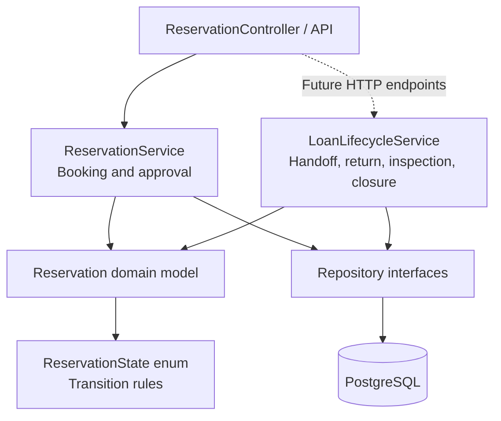

# ADR-004: Apply the Single Responsibility Principle to the Reservation Lifecycle

**Project:** NeighbourLend — Community Equipment & Tool Sharing Hub  
**Date recorded:** 2026-11-15  
**Status:** Accepted (implemented)  
**Design approach:** SOLID — Single Responsibility Principle (SRP), guided by **“One Class, One Job”**  
**Scope:** Laravel backend — reservation application services and domain behavior

## Context

NeighbourLend supports two related, but distinct, business workflows:

1. **Reservation management:** a borrower requests a tool, receives a price calculation, and may cancel a request; an owner may approve a request.
2. **Physical loan lifecycle:** after approval, the tool is handed over, returned, inspected, and either returned to availability after successful closure or flagged for a dispute.

An earlier design concentrated these workflows in `ReservationService`. This meant a change to reservation pricing, date validation, or conflict handling could affect the same class that handled handoff and post-return inspection. The combined responsibilities made the service harder to understand, change, and test independently.

The refactoring was introduced through [PR #18](https://github.com/friera92/cen5064-project-flores/pull/18) and [PR #21](https://github.com/friera92/cen5064-project-flores/pull/21).

**Terminology:** SRP is a SOLID *design principle*, not a Gang of Four (GoF) design pattern. “One Class, One Job” is a practical shorthand for SRP: a class should have **one principal responsibility, or one reason to change**. It does not mean a class must contain only one method.

## Decision

**Separate reservation administration from the physical lending lifecycle into two focused application services.** Keep state-transition invariants in the Domain layer and persistence operations behind repository interfaces.

| Component | Primary responsibility | Operations implemented |
| --- | --- | --- |
| `ReservationService` | Manage reservation requests and booking-related decisions | `requestTool()`, `approveReservation()`, `cancelReservation()`, `calculateCost()`, `getReservarionById()` |
| `LoanLifecycleService` | Coordinate the physical handoff, return, inspection, and closure of a loan | `handOffTool()`, `returnTool()`, `inspectTool()`, `closeReservation()` |
| `Reservation` (Domain model) | Protect the reservation's state invariant | `transitionTo(ReservationState $newState)` |
| `ReservationState` (Domain enum) | Define valid transitions and inspection eligibility | `canTransitionTo()`, `canBeInspected()` |
| `ReservationRepositoryInterface`, `ToolRepositoryInterface` | Abstract persistence operations used by the services | Lookup, creation, saving, locking, and overlap queries through their implementations |

Both services depend on repository **interfaces**, which are bound to implementations through Laravel's service container. This additionally supports Dependency Inversion (DIP), but **SRP is the primary decision documented here**.

## Responsibility boundaries

### 1. `ReservationService` — booking decisions

This class is responsible for creating and managing a reservation *before the physical loan begins*. It validates booking dates, checks whether a tool is available, rejects overlapping requests, calculates the price on the server, and coordinates approval or cancellation by authorized users.

Its primary reason to change is a modification to **reservation policy** — for example, rental pricing, booking overlap rules, or request/cancellation behavior.

### 2. `LoanLifecycleService` — physical loan operations

This class coordinates what happens *after an approved reservation*. It records handoff (`ACTIVE`), borrower return (`RETURNED`), owner inspection, and successful closure (`CLOSED`). It also updates the tool's availability or maintenance status as part of these operations.

Its primary reason to change is a modification to **handoff, return, inspection, or loan-completion policy** — for example, changing the inspection process or the tool status resulting from a damaged return.

These operations use database transactions to keep changes to the reservation and the tool consistent.

### 3. Domain layer — state-transition rules

Neither application service owns the list of allowed state transitions. Instead, both call `Reservation::transitionTo()`, which delegates validation to `ReservationState::canTransitionTo()` and rejects invalid transitions with a `DomainException`.

For example:

```php
// Application service: coordinates the operation.
$reservation->transitionTo(ReservationState::ACTIVE);

// Domain model: ensures the transition is legal.
public function transitionTo(ReservationState $newState): void
{
    $currentState = $this->status;
    if (!$currentState->canTransitionTo($newState)) {
        throw new DomainException(
            "Invalid reservation transition: {$currentState->value} -> {$newState->value}"
        );
    }
    $this->status = $newState;
}
```

This preserves a single source of truth for transitions such as `REQUESTED → APPROVED → ACTIVE → RETURNED → CLOSED` and prevents invalid moves, such as `CANCELED → APPROVED`.

## Design overview



The diagram depicts the intended separation. As of this ADR's recording, the existing API exposes borrower-facing reservation operations; several lifecycle methods exist in `LoanLifecycleService` but their corresponding HTTP endpoints are still planned (GitHub issues [#35](https://github.com/friera92/cen5064-project-flores/issues/35) and [#36](https://github.com/friera92/cen5064-project-flores/issues/36)).

## Alternatives considered

| Alternative | Assessment |
| --- | --- |
| Keep all reservation and loan actions in `ReservationService` | Fewer classes, but multiple business responsibilities and reasons to change; **rejected**. |
| Split into `ReservationService` and `LoanLifecycleService` with shared Domain rules | Clearer responsibilities, focused tests, and compatibility with existing architecture; **selected**. |
| Put all workflow coordination in the `Reservation` Eloquent model | Would mix transaction orchestration and persistence collaboration with domain invariants; **not selected**. |
| Introduce separate microservices for booking and lending | Unnecessary deployment and communication complexity for the current monolithic project; **not selected**. |

## Consequences

**Benefits**

- A change in booking rules does not require modifying the class that coordinates physical returns and inspection.
- Service methods are grouped by business responsibility, making the code easier to navigate and review.
- Each workflow can be tested independently while sharing the same domain transition rules.
- Repository interfaces reduce coupling to concrete data-access implementations.
- Domain rules remain consistent across current and future entry points (HTTP controllers, commands, or tests).

**Trade-offs and limitations**

- More classes and dependency-injection bindings increase structural complexity slightly.
- Both services work with reservations and tools; this is intentional collaboration, not duplicated ownership of state rules.
- `LoanLifecycleService::inspectTool()` still uses a condition-based `switch`. A future Strategy-based extension may be useful if inspection rules grow; no such refactoring is required by this ADR.
- Expected domain errors still need consistent HTTP mapping as the remaining endpoints are implemented; splitting services alone does not complete the frontend-to-backend workflow.

## Verification and evidence

- **Implementation:** [PR #18 — SRP/DIP refactor](https://github.com/friera92/cen5064-project-flores/pull/18) and [PR #21 — Separate ReservationService and LoanLifecycleService](https://github.com/friera92/cen5064-project-flores/pull/21).
- **Domain protection:** `neighbourlend/app/Domain/Models/Reservation.php` and `neighbourlend/app/Domain/States/ReservationState.php`.
- **Services:** `neighbourlend/app/Services/ReservationService.php` and `neighbourlend/app/Services/LoanLifecycleService.php`.
- **Automated tests:** [PR #34 — Reservation state and API-flow tests](https://github.com/friera92/cen5064-project-flores/pull/34). The merged PR documents 9 state tests (39 assertions) and 8 flow tests (51 assertions); GitHub Actions checks passed before and after its merge.
- **Pending integration work:** [#35 — lender reservation/approval API](https://github.com/friera92/cen5064-project-flores/issues/35), [#36 — remaining lifecycle API](https://github.com/friera92/cen5064-project-flores/issues/36), [#37 — lender dashboard](https://github.com/friera92/cen5064-project-flores/issues/37), [#38 — remaining frontend workflow](https://github.com/friera92/cen5064-project-flores/issues/38), and [#39 — HTTP tests](https://github.com/friera92/cen5064-project-flores/issues/39).

## Relationship to other architectural decisions

- [ADR-001](adr-001.md): Three-tier architecture — this decision operates within the Laravel backend.
- [ADR-002](adr-002.md): Repository and Service Layer patterns — this ADR refines the service boundaries without replacing either pattern.
- [ADR-003](adr-003.md): Reservation state machine — state validity belongs to the Domain model and enum. The older ADR's wording about enforcement by the service reflects an earlier implementation and should be aligned with current code during a future documentation review.

## Final rationale

The decision applies **“One Class, One Job”** by assigning **reservation policy** to `ReservationService`, **physical loan lifecycle coordination** to `LoanLifecycleService`, and **state-transition validity** to the Domain layer. Each component has a distinct reason to change, while the existing Laravel service/repository architecture and database transactions are preserved.
